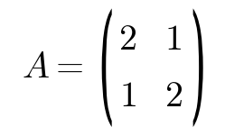
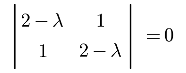
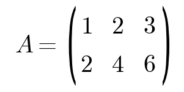
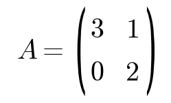
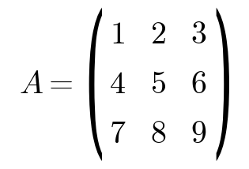

# 🚀 IC 帝国理工 EDMSL 面试冲刺手册
# 🚀 IC Imperial College EDMSL Interview Sprint Handbook

---

# ⚡ 时间紧？按这个优先级
# ⚡ Short on Time? Follow This Priority

| 天数 (Day) | 干什么 (Task) | 预计耗时 (Est. Time) |
|------------|---------------|---------------------|
| Day 1 | 🔥 ODE 积分因子法 + Euler 法能手算 + 特征值/特征向量 | 4-5h |
| Day 2 | 🔥 Python 水果 CSV 题 3 种写法 + list/set/不可变类型 + 局部最大值 | 4-5h |
| Day 3 | General 话术 + 项目 L1-L5 过一遍 + 模拟一遍 | 3-4h |

**EN:** Day 1: ODE integrating factor method + Euler method (must be able to compute by hand) + eigenvalues/eigenvectors
**EN:** Day 2: Python fruit CSV question with 3 approaches + list/set/immutable types + local maxima
**EN:** Day 3: General scripts + project L1-L5 walkthrough + mock interview

> 如果只够 1 天：**先刷 Part III 数学和编程**，General 临场编也能圆，数学编程不会直接挂。

**EN: If you only have 1 day: Focus on Part III Math and Coding first. General questions can be improvised on the spot, but failing math/coding will get you rejected directly.**

---

# 🗺️ 面试全景卡（先心里有数）
# 🗺️ Interview Overview Card (Get the Big Picture First)

| 项目 (Item) | 详情 (Details) |
|------------|---------------|
| 形式 | Zoom / Skype 平行线上 |
| 时长 | 20-40 min（大部分 30 min） |
| 考官 | EDMSL 项目在职教授 |
| 结构 | General (5-10min) → Project (10-15min) → **Skill Test (10-15min)** ← 最容易挂 |

**EN:** Format: Zoom / Skype parallel online interview
**EN:** Duration: 20-40 min (mostly around 30 min)
**EN:** Interviewer: Faculty members from the EDMSL programme
**EN:** Structure: General (5-10min) → Project (10-15min) → **Skill Test (10-15min)** ← This is where most people fail

---

# Part I · General Questions

> 目标：流利 1 分钟，引导面试官到你准备好的方向。不要等面试官问，主动说。

**EN: Goal: Speak fluently for 1 minute, guide the interviewer toward topics you've prepared. Don't wait for them to ask — be proactive.**

---

## 1.1 必考 5 题 + 你可以直接套的模板
## 1.1 Five Mandatory Questions + Ready-to-Use Templates

### Q1 · Motivation（第一个问题，必问）
### Q1 · Motivation (First question, guaranteed)

**面试官在想啥：** 你真的了解 EDMSL 还是海投？

**EN: What the interviewer is thinking: Do you genuinely know EDMSL, or are you just mass-applying?**

**回答框架（三段式，别废话）：**

**EN: Answer framework (three-part structure, no fluff):**

```
① 触发点：一个具体的经历/课程（别说"我一直想学AI"）
② 匹配点：IC EDMSL 的 1-2 门具体课程 + 你的背景能贡献啥
③ 差异化：IC EDMSL 和别的学校不一样的地方
```

**EN:**
```
① Trigger point: A specific experience/course (don't say "I've always wanted to learn AI")
② Match point: 1-2 specific courses from IC EDMSL + what your background contributes
③ Differentiation: What makes IC EDMSL different from other schools
```

**示例（可以抄结构）：**

**EN: Example (you can borrow this structure):**

> "My interest started when I took *Computational Methods in Geography* — we used PCA to analyze 50 years of temperature anomaly data across China, and that's when I realized environmental problems need both domain knowledge and ML. IC EDMSL's *Advanced Machine Learning for Earth Observation* directly covers this intersection. Also, your group's work on climate model downscaling is exactly what I want to explore."

**❌ 千万别这么答：** "I've always been interested in AI and environment, so IC is my dream school."

**EN: ❌ NEVER answer like this:** "I've always been interested in AI and environment, so IC is my dream school."

---

### Q2 · 1 分钟自我介绍
### Q2 · 1-Minute Self-Introduction

**结构：** `姓名 + 学校/专业 + 1 个硬亮点（GPA/排名/奖项）+ 1 个相关经历收尾`

**EN: Structure:** `Name + School/Major + 1 solid highlight (GPA/ranking/award) + 1 relevant experience to wrap up`

**最后一句必须引向你准备好的项目** —— 这样面试官自然就顺着你准备好的方向问了。

**EN: Your last sentence MUST lead into a project you've prepared** —— this way the interviewer will naturally follow your prepared direction.

---

### Q3 · CV / PS 细节追问
### Q3 · CV / PS Follow-Up Questions

面试官能把你 CV 上**每一行**挖 3 层。你必须能对 CV 上每个项目说出：

**EN: The interviewer can dig 3 layers deep into EVERY line of your CV. You must be able to say for every project on your CV:**

| 他们会挖什么 (What They'll Probe) | 你要能答 (What You Need to Answer) |
|----------------------------------|-----------------------------------|
| 做了什么 | 一句话概述 |
| 为什么选这个方法 | 方法选择的理由（试过什么，比下来哪个好） |
| 底层数学/技术 | 能用的 → 能讲清底层（用了 PCA → 能说特征值分解） |
| 结果靠谱吗 | 不能只说"效果好" → 说验证方法 |

**EN:**
- What you did: A one-sentence summary
- Why this method: Justification for method choice (what you tried, why this one is better)
- Underlying math/tech: If you used it → explain the fundamentals (used PCA → explain eigenvalue decomposition)
- Are results reliable: Don't just say "it worked well" → explain your validation method

**你可以这样练：** 把 CV 逐行念出来，自己随机挑一行，追问自己 3 层，答不上来就标记回去补。

**EN: Practice method: Read your CV line by line, randomly pick a line, and ask yourself 3 layers deep. Mark anything you can't answer and go back to study it.**

---

### Q4 · Why IC / Why EDMSL
### Q4 · Why IC / Why EDMSL

**别和 Motivation 重复。** 重点讲 IC 的**资源 / 声誉 / 地理位置**。

**EN: Don't repeat your Motivation answer.** Focus on IC's **resources / reputation / location**.

### Q5 · 未来规划
### Q5 · Future Plans

**别空。** 结合 EDMSL 的方向。别说 "I want to be a data scientist" —— 要说 "I want to work on remote sensing + ML for carbon monitoring"。

**EN: Don't be vague.** Tie it to EDMSL's directions. Don't say "I want to be a data scientist" —— say "I want to work on remote sensing + ML for carbon monitoring".

---

## 1.2 General 部分速查表
## 1.2 General Section Quick Reference

| # | 题目 (Question) | 优先级 (Priority) | 你要做什么 (What You Need to Do) |
|---|-----------------|-------------------|----------------------------------|
| 1 | Walk me through your CV | ★★★★★ | 准备 2 分钟版本，主动引导 |
| 2 | Why EDMSL at IC？ | ★★★★★ | 上官网找 1-2 门具体课程塞进回答 |
| 3 | 最相关的一门课 | ★★★★ | 找 EDMSL 课程手册里的对应项 |
| 4 | 会什么编程语言？哪个最熟？ | ★★★★ | 诚实说，但准备一个能展开的 |
| 5 | numpy / pandas 会吗 | ★★★ | 会就说，准备一个场景 |
| 6 | Python class / OOP 经验？ | ★★★ | 准备一个小例子 |
| 7 | Future career plan | ★★ | 别空，结合 EDMSL 方向 |

**EN:**
1. Walk me through your CV: Prepare a 2-minute version, guide proactively
2. Why EDMSL at IC?: Find 1-2 specific courses on the official website to weave into your answer
3. Most relevant course: Find the match in the EDMSL course handbook
4. What programming languages do you know? Which are you most proficient in?: Be honest, but prepare one you can elaborate on
5. Do you know numpy / pandas?: Say yes if you do, prepare a use case
6. Python class / OOP experience?: Prepare a small example
7. Future career plan: Don't be vague, tie to EDMSL directions

---

# Part II · Personal Project

> **第二大挂科重灾区！** 你以为讲清楚做了什么就够了？面试官追到数学原理。

**EN: **Second biggest failure zone!** You think explaining what you did is enough? The interviewer will dig into the mathematical principles.**

---

## 2.1 项目答辩清单（对着自己的项目逐个 ✅）
## 2.1 Project Defense Checklist (Go Through Your Own Project Item by Item ✅)

| 层级 (Level) | 他们会问 (What They'll Ask) | 你要能答 (What You Need to Answer) |
|-------------|---------------------------|-----------------------------------|
| **L1 · 做了什么** | "Tell me about this project" | 一句话概述 + 你的具体贡献 |
| **L2 · 用了什么** | "What method did you use" | 具体算法/工具/数据量 |
| **L3 · 为什么选这个** | "Why not try X instead" | 试过啥方法比较下来选这个的理由 |
| **L4 · 数学原理** | "Can you explain how that works mathematically" | 底层公式能讲（PCA → 特征值分解，RF → Gini/信息增益） |
| **L5 · 结果靠谱吗** | "How did you verify your results" | 交叉验证 / 时间分割 / 混淆矩阵 —— 不能只说 score |

**EN:**
- **L1 · What you did:** One-sentence summary + your specific contributions
- **L2 · What you used:** Specific algorithm/tools/data volume
- **L3 · Why this choice:** What you tried and why you chose this one over alternatives
- **L4 · Mathematical principles:** Explain the underlying formulas (PCA → eigenvalue decomposition, RF → Gini/information gain)
- **L5 · Are results reliable:** Cross-validation / time splitting / confusion matrix —— don't just state the score

**自测方法：** 拿你的主项目，从 L1 一路自问自答到 L5。任何一层卡壳 → 回去补。

**EN: Self-test method: Take your main project, go from L1 to L5 asking and answering yourself. If you get stuck at any level → go back and study.**

---

## 2.2 高分项目三个标志（看你中了几个）
## 2.2 Three Signs of a Strong Project (See How Many You Have)

1. **有数据量：** 至少几千条（不是 100 条 demo）
2. **有比较：** 试过多种方法并说清楚为什么选 A 不选 B
3. **有验证：** 有交叉验证 / 时间分割，不是只给一个 accuracy

**EN:**
1. **Has data volume:** At least a few thousand records (not a 100-record demo)
2. **Has comparison:** Tried multiple methods and clearly explained why you chose A over B
3. **Has validation:** Has cross-validation / time splitting, not just a single accuracy number

---

# 🔥 Part III-A · Math 数学（关键）
# 🔥 Part III-A · Math (Critical)

> 面经里超过一半的人说数学部分答得不好。这部分 **必须练到手算不卡**。
> 每个考点：**知识卡片记住 → 真题手算一遍 → 练习题自测**

**EN: More than half of candidates in interview reports say they did poorly on the math section. You MUST practice until you can do calculations by hand without getting stuck.**
**EN: For each topic: Memorize the knowledge card → work through a real interview question by hand → test yourself with practice problems**

---

## 3.1 微分方程 ODE（必考 ★★★★★）
## 3.1 Differential Equations ODE (Guaranteed ★★★★★)

### 📑 你必须记住的公式
### 📑 Formulas You Must Memorize

**一阶线性 ODE 标准形式：**

**EN: Standard form of first-order linear ODE:**

$$\frac{dy}{dx} + P(x)y = Q(x)$$

**积分因子法四步（背下来）：**

**EN: Four steps of the integrating factor method (memorize this):**

1. 算积分因子  $\mu(x) = e^{\int P(x)\, dx}$
2. 两边乘 $\mu(x)$ → 左边凑成 $\frac{d}{dx}[\mu(x) \cdot y]$
3. 两边积分 → $\mu(x) \cdot y = \int \mu(x) Q(x)\, dx + C$
4. 解出 $y$ → $y = \frac{1}{\mu(x)} \left[ \int \mu(x) Q(x)\, dx + C \right]$"

**Euler 法（显式欧拉，数值解必考）：**

**EN: Euler method (explicit Euler, guaranteed for numerical solutions):**

$$y_{n+1} = y_n + h \cdot f(x_n, y_n)$$

就是：**下一个点 = 当前点 + 步长 × 当前斜率**

**EN: In words: Next point = Current point + Step size × Current slope**

**RK4（精度更高，偶尔考）：**

**EN: RK4 (higher accuracy, occasionally tested):**

$$k_1 = f(x_n, y_n)$$
$$k_2 = f(x_n + h/2, y_n + h k_1/2)$$
$$k_3 = f(x_n + h/2, y_n + h k_2/2)$$
$$k_4 = f(x_n + h, y_n + h k_3)$$
$$y_{n+1} = y_n + \frac{h}{6}(k_1 + 2k_2 + 2k_3 + k_4)$$

---

### 🎯 真题手算（现在就拿纸算一遍）
### 🎯 Real Interview Questions — Work Them Out By Hand Right Now

**真题 1：** 求解 $y' - 2y = e^{3x}$，$y(0) = 0$

**EN: Real question 1:** Solve $y' - 2y = e^{3x}$, $y(0) = 0$

<details><summary>点我看标准答案 / Click to see the standard answer</summary>

Step 1: $P(x) = -2$, $Q(x) = e^{3x}$
Step 2: $\mu(x) = e^{\int (-2)\, dx} = e^{-2x}$
Step 3: $e^{-2x} \cdot y' - 2e^{-2x} \cdot y = e^{x}$  →  $\frac{d}{dx}[e^{-2x} \cdot y] = e^{x}$
Step 4: $e^{-2x} \cdot y = \int e^{x}\, dx = e^{x} + C$
Step 5: $y = e^{3x} + C \cdot e^{2x}$
Step 6: $y(0) = 0$ → $0 = 1 + C$ → $C = -1$ → $y = e^{3x} - e^{2x}$

</details>

---

**真题 2（Parastoo 老师考过）：** Euler 法 h=0.1，解 $y' = y + x$，$y(0)=1$，走到 x=0.3

**EN: Real question 2 (asked by Prof. Parastoo):** Euler method with h=0.1, solve $y' = y + x$, $y(0)=1$, step to x=0.3

<details><summary>点我看标准答案 / Click to see the standard answer</summary>

```
f(x,y) = y + x, h = 0.1

x0=0,  y0=1
x1=0.1, y1 = 1 + 0.1*(1+0) = 1.1
x2=0.2, y2 = 1.1 + 0.1*(1.1+0.1) = 1.22
x3=0.3, y3 = 1.22 + 0.1*(1.22+0.2) = 1.3622

→ y(0.3) ≈ 1.3622
```

</details>

---

### 📝 自测题（遮住答案算）
### 📝 Self-Test Questions (Cover the answers and work them out)

| # | 题目 (Question) | 难度 (Difficulty) |
|---|----------------|-------------------|
| 1 | 求解 $y' + 3y = 6$ | 基础 |
| 2 | 求解 $y' - y = \cos x$，$y(0) = 1$ | 中等 |
| 3 | Euler h=0.2 解 $y' = 2y - x$，$y(0)=1$，到 x=0.4 | 基础 |
| 4 | RK4 h=0.1 解 $y' = x - y$，$y(0)=2$，到 x=0.2 | 中等 |

**EN:**
1. Solve $y' + 3y = 6$ — Basic
2. Solve $y' - y = \cos x$, $y(0) = 1$ — Medium
3. Euler h=0.2 solve $y' = 2y - x$, $y(0)=1$, to x=0.4 — Basic
4. RK4 h=0.1 solve $y' = x - y$, $y(0)=2$, to x=0.2 — Medium

---

## 3.2 线性代数（必考 ★★★★★）
## 3.2 Linear Algebra (Guaranteed ★★★★★)

### 📑 你必须记住的
### 📑 What You Must Memorize

**特征值 & 特征向量：**

**EN: Eigenvalues & Eigenvectors:**

$$A\mathbf{v} = \lambda\mathbf{v} \quad \Rightarrow \quad \det(A - \lambda I) = 0$$

**PCA 和特征值（面经高频追问，必须能说）：**

**EN: PCA and eigenvalues (frequently asked in interviews, you must be able to explain this):**

> PCA 就是对**协方差矩阵**做特征值分解。
> 
> - 特征值 $\lambda_i$ = 对应方向上的**方差大小**
> - 特征向量 = 主成分的**方向**
> - 按 $\lambda_1 \geq \lambda_2 \geq \cdots$ 排序，取前 k 个 → 保留最多的方差

**EN:**
> PCA is simply eigenvalue decomposition on the **covariance matrix**.
> 
> - Eigenvalue $\lambda_i$ = the **amount of variance** in the corresponding direction
> - Eigenvector = the **direction** of the principal component
> - Sort by $\lambda_1 \geq \lambda_2 \geq \cdots$, take the top k → preserves the most variance

**矩阵的秩：**

**EN: Matrix rank:**

- 线性无关行/列的最大数量
- 满秩 $\iff$ $\det(A) \neq 0$ $\iff$ 可逆

**EN:**
- The maximum number of linearly independent rows/columns
- Full rank $\iff$ $\det(A) \neq 0$ $\iff$ invertible

---

### 🎯 真题手算
### 🎯 Real Interview Questions — Work Them Out

**真题 1：** 求  的特征值和特征向量

**EN: Real question 1:** Find the eigenvalues and eigenvectors of 

<details><summary>点我看标准答案 / Click to see the standard answer</summary>

$\det(A - \lambda I) = 0$:



$(2-\lambda)^2 - 1 = 0$ → $\lambda^2 - 4\lambda + 3 = 0$ → $\lambda_1 = 1$, $\lambda_2 = 3$

$\lambda_1 = 1$: $(A-I)\mathbf{v} = 0$ → $\mathbf{v}_1 = (1, -1)^T$

$\lambda_2 = 3$: $(A-3I)\mathbf{v} = 0$ → $\mathbf{v}_2 = (1, 1)^T$

</details>

---

**真题 2：** 矩阵  的秩？为什么？

**EN: Real question 2:** What is the rank of ? Why?

<details><summary>点我看标准答案 / Click to see the standard answer</summary>

```
Rank = 1

因为第二行 = 第一行 × 2，两行线性相关。
所以只有 1 行线性无关 → 秩 = 1。

EN: Rank = 1
Because row 2 = row 1 × 2, the two rows are linearly dependent.
So there is only 1 linearly independent row → rank = 1.
```

</details>

---

### 📝 自测题
### 📝 Self-Test Questions

| # | 题目 (Question) | 难度 (Difficulty) |
|---|----------------|-------------------|
| 1 |  的特征值 | 基础 |
| 2 |  的秩 | 中等 |
| 3 | 为什么 PCA 要找最大的特征值？（用嘴说出来） | 中等 |

**EN:**
1. Eigenvalues of  — Basic
2. Rank of  — Medium
3. Why does PCA look for the largest eigenvalues? (Explain verbally) — Medium

---

## 3.3 微积分 & 统计
## 3.3 Calculus & Statistics

### 📑 你要能说清楚的
### 📑 What You Need to Be Able to Explain

**梯度下降（面经考过）：**

**EN: Gradient descent (asked in interviews):**

$$\theta_{t+1} = \theta_t - \eta \cdot \nabla_\theta J(\theta)$$

> 梯度指向**损失上升最快**的方向 → 负梯度就是**下降最快**的方向。

**EN:**
> The gradient points in the direction of **steepest increase** in loss → the negative gradient is the direction of **steepest decrease**.

**局部最大值：** 比左右邻居都大的位置（结合编程考）

**EN: Local maximum:** A position that is larger than both its left and right neighbors (tested together with coding questions)

**95% 置信区间：** $\bar{x} \pm 1.96 \cdot \frac{\sigma}{\sqrt{n}}$

**EN: 95% confidence interval:** $\bar{x} \pm 1.96 \cdot \frac{\sigma}{\sqrt{n}}$

---

# 🔥 Part III-B · Code 编程（重灾区）
# 🔥 Part III-B · Code (Disaster Zone)

> ⚠️ **水果 CSV 题出现 4+ 次！** 必须熟。
> 编程考察方式：**至少两种方法** + **解释每一行怎么想的** + 可能追问数学原理

**EN: ⚠️ The fruit CSV question has appeared 4+ times!** You MUST master it.
**EN: Coding assessment format: At least two approaches + explain your thinking for each line + possible follow-up on mathematical principles**

---

## 3.4 Python 基础概念（必考 ★★★★★）
## 3.4 Python Basic Concepts (Guaranteed ★★★★★)

### 📑 一眼看懂的对比表
### 📑 Quick Reference Comparison Table

| 属性 (Attribute) | list | set | tuple |
|-----------------|------|-----|-------|
| 有序 | ✅ | ❌ | ✅ |
| 可变 | ✅ | ✅ | ❌ |
| 允许重复 | ✅ | ❌ | ✅ |
| 常用 | 索引、append | 去重、集合运算 | 不可变 key |

**EN:**
- Ordered: list ✅, set ❌, tuple ✅
- Mutable: list ✅, set ✅, tuple ❌
- Allows duplicates: list ✅, set ❌, tuple ✅
- Common uses: list — indexing, append; set — deduplication, set operations; tuple — immutable key

**不可变类型（immutable）：** `int, float, str, tuple, frozenset, bool`

**EN: Immutable types:** `int, float, str, tuple, frozenset, bool`

> tuple 可以做 dict key，list 不行。因为 dict key 必须 hashable（= 不可变）。

**EN:**
> tuple can be a dict key, list cannot. Because dict keys must be hashable (= immutable).

---

### 🎯 经典真题
### 🎯 Classic Interview Questions

**Q1：list 和 set 有什么区别？**

**EN: Q1: What's the difference between list and set?**

<details><summary>标准答案 / Standard Answer</summary>

1. list 有序、可 index；set 无序、不能 index
2. list 允许重复；set 自动去重
3. set 查找 O(1)（哈希），list 查找 O(n)
4. set 支持 union / intersection / difference
5. set 元素必须是 hashable（不可变类型）

**EN:**
1. list is ordered and indexable; set is unordered and not indexable
2. list allows duplicates; set automatically deduplicates
3. set lookup is O(1) (hash-based), list lookup is O(n)
4. set supports union / intersection / difference operations
5. set elements must be hashable (immutable types)

</details>

---

**Q2：Python 哪些类型是 immutable？**

**EN: Q2: Which Python types are immutable?**

<details><summary>标准答案 / Standard Answer</summary>

`int, float, str, tuple, frozenset, bytes, bool`

面试加分补充：这就是为什么 tuple 能做 dict key 但 list 不行 —— hashable 要求不可变。

**EN: Bonus point to mention: This is why tuple can be a dict key but list cannot — hashability requires immutability.**

</details>

---

## 3.5 编程实操题（按面经频率排序）
## 3.5 Hands-On Coding Questions (Sorted by Interview Frequency)

### 🏆 题目 1：CSV 水果平均重量（4+ 次！必须熟）
### 🏆 Question 1: CSV Fruit Average Weight (4+ times! Must master)

**面试官说：** "给你一个 CSV，每行水果名和重量，算每种水果的平均重量。至少两种方法。"

**EN: Interviewer says:** "Here's a CSV with each row containing a fruit name and weight. Calculate the average weight for each fruit type. Use at least two methods."

#### 方法一：pandas（最简洁）
#### Method 1: pandas (Most concise)

```python
import pandas as pd

df = pd.read_csv("fruits.csv")
result = df.groupby("fruit")["weight"].mean()
print(result)
```

#### 方法二：csv + defaultdict（面试官最爱看，不用 pandas）
#### Method 2: csv + defaultdict (Interviewer's favorite, no pandas)

```python
import csv
from collections import defaultdict

fruit_weight_sum = defaultdict(float)   # 自动处理新 key
fruit_count = defaultdict(int)

with open("fruits.csv", "r") as f:
    reader = csv.DictReader(f)          # 自动读表头
    for row in reader:
        fruit_weight_sum[row["fruit"]] += float(row["weight"])
        fruit_count[row["fruit"]] += 1

for fruit in fruit_weight_sum:
    print(f"{fruit}: {fruit_weight_sum[fruit]/fruit_count[fruit]:.2f}")
```

#### 方法三：numpy（面试官追问第三种）
#### Method 3: numpy (Interviewer asks for a third approach)

```python
import pandas as pd
import numpy as np

df = pd.read_csv("fruits.csv")
print(df.groupby("fruit")["weight"].apply(np.mean))
```

> **练习建议：** 建一个 `fruits.csv` 假数据，三种方法都跑一遍，面试时确保不卡。

**EN: Practice suggestion:** Create a fake `fruits.csv` dataset, run all three methods, and make sure you can do them smoothly during the interview.

---

### 🏆 题目 2：找数组局部最大值
### 🏆 Question 2: Find Local Maxima in Array

**面试官说：** "写函数找出数组中所有局部最大值"

**EN: Interviewer says:** "Write a function to find all local maxima in an array"

```python
def find_local_max(arr):
    result = []
    for i in range(1, len(arr) - 1):    # 跳过首尾
        if arr[i] > arr[i-1] and arr[i] > arr[i+1]:
            result.append((i, arr[i]))
    return result

# 测试
data = [1, 3, 2, 5, 1, 4, 3]
print(find_local_max(data))   # [(1, 3), (3, 5), (5, 4)]
```

---

### 🏆 题目 3：矩阵乘法（不用 numpy）
### 🏆 Question 3: Matrix Multiplication (Without numpy)

```python
def matrix_multiply(A, B):
    m, n = len(A), len(A[0])
    n2, p = len(B), len(B[0])
    result = [[0]*p for _ in range(m)]
    for i in range(m):
        for j in range(p):
            for k in range(n):
                result[i][j] += A[i][k] * B[k][j]
    return result
```

---

### 📝 编程自测（现在打开 Jupyter 写）
### 📝 Coding Self-Test (Open Jupyter and write these now)

| # | 题目 (Question) | 必过？ (Must Pass?) |
|---|----------------|---------------------|
| 1 | CSV 水果平均重量（至少两种方法） | 🔥 必过 |
| 2 | 数组局部最大值 | 🔥 必过 |
| 3 | 矩阵乘法（不用 numpy） | 建议过 |
| 4 | defaultdict 统计词频 | 建议过 |
| 5 | 手写一个 class（deposit/withdraw） | 了解 |

**EN:**
1. CSV fruit average weight (at least two methods) — 🔥 Must pass
2. Array local maxima — 🔥 Must pass
3. Matrix multiplication (without numpy) — Recommended
4. defaultdict word frequency count — Recommended
5. Write a class by hand (deposit/withdraw) — Understand

---

# Part IV · 面试官画像（先查你被分配给谁）
# Part IV · Interviewer Profiles (Check Who You're Assigned To First)

| 老师 (Professor) | 风格 (Style) | 你要重点准备 (What to Focus On) |
|-----------------|-------------|--------------------------------|
| **Parastoo Salehi** | 简洁直接，不绕弯 | 线性 ODE + Python 局部最大值 |
| **Marijan** | 喜欢追问，数值方法专业 | ODE 数值解（Euler/RK4）能手算 + CV 深挖到 L4 |
| **Fredrick** | 节奏快，追问应用 | 准备 1-2 个 ODE 的物理/环境应用场景 |
| **Nelson** | 标准考察 | 基础题别错，走标准流程就行 |
| **Ames** | 经典题套路 | 水果题 3 种方法 + 特征值稳 |

**EN:**
- **Parastoo Salehi:** Concise and direct, no beating around the bush → Focus on linear ODE + Python local maxima
- **Marijan:** Likes to dig deeper, specializes in numerical methods → Be able to compute ODE numerical solutions (Euler/RK4) by hand + prepare CV to L4 depth
- **Fredrick:** Fast pace, asks about applications → Prepare 1-2 physical/environmental application scenarios for ODEs
- **Nelson:** Standard assessment → Don't mess up basic questions, follow the standard flow
- **Ames:** Classic question patterns → Fruit CSV question with 3 methods + solid eigenvalue skills

---

# Part V · 考前 Checklist
# Part V · Pre-Interview Checklist

## ✅ 进场前 5 分钟，对照自查
## ✅ 5 Minutes Before the Interview, Check These

### General
- [ ] Motivation 三段式能流利讲 1 分钟
- [ ] CV 每一行能答到 L3 以上
- [ ] 准备好 3whys

**EN:**
- [ ] Can deliver the three-part Motivation answer fluently for 1 minute
- [ ] Can answer every line on CV to at least L3 depth
- [ ] Prepared for the 3 whys

### Project
- [ ] 主项目 L1-L5 全部能答
- [ ] 能说清楚方法比较结论
- [ ] 能说清楚验证方法

**EN:**
- [ ] Can answer L1-L5 for main project
- [ ] Can clearly explain method comparison conclusions
- [ ] Can clearly explain validation methods

### Math 🔥
- [ ] 一阶线性 ODE 积分因子法能手算
- [ ] Euler 法能手算
- [ ] 特征值/特征向量能手算 2×2
- [ ] PCA ↔ 特征值分解的逻辑通

**EN:**
- [ ] Can compute first-order linear ODE using integrating factor method by hand
- [ ] Can compute Euler method by hand
- [ ] Can compute eigenvalues/eigenvectors for 2×2 matrices by hand
- [ ] Understand the logic connecting PCA ↔ eigenvalue decomposition

### Code 🔥
- [ ] 水果 CSV 至少两种方法熟写
- [ ] list vs set vs tuple 区别能说
- [ ] 不可变类型能说全
- [ ] 局部最大值会写

**EN:**
- [ ] Can write at least two methods for the fruit CSV question fluently
- [ ] Can explain differences between list vs set vs tuple
- [ ] Can list all immutable types
- [ ] Can write the local maxima function

### 心态
- [ ] 准备好诚实回答："Hmm, I'm not entirely sure, but let me think about it..."
- [ ] 知道老师很 nice，答错会引导，别慌

**EN: Mindset:**
- [ ] Prepared to answer honestly: "Hmm, I'm not entirely sure, but let me think about it..."
- [ ] Know that the professors are nice — they'll guide you if you get it wrong, don't panic

---

## ⏰ 面试 30 分钟时间分配（心里有数）
## ⏰ 30-Minute Interview Time Allocation (Know This)

```
0:00 - 0:30   开场 + Intro（主动引到你准备的方向）
0:30 - 3:00   Motivation + 3whys
3:00 - 10:00  Personal Project（用 L1-L5 主动展开）
10:00 - 25:00 Math + Code（核心！慢慢来，说 how you think）
25:00 - 30:00 Q&A（反问要准备 1-2 个有水平的）
```

**EN:**
```
0:00 - 0:30   Opening + Intro (proactively guide toward your prepared topics)
0:30 - 3:00   Motivation + 3 whys
3:00 - 10:00  Personal Project (use L1-L5 structure to expand proactively)
10:00 - 25:00 Math + Code (the core! Take your time, explain your thinking process)
25:00 - 30:00 Q&A (prepare 1-2 thoughtful questions to ask back)
```

---

## 💡 反问环节（你问什么？）
## 💡 The "Ask Back" Round (What Should You Ask?)

**好问题（显得你调研过）：**

**EN: Good questions (show you've done your research):**

> "I read that your group is working on X — can you tell me more about how EDMSL students get involved?"
> "The course *Advanced ML for Earth Observation* looks very relevant — is it offered in Term 1?"

**❌ 别问：** "When will I get my offer？" / "Is this interview important？"

**EN: ❌ Don't ask:** "When will I get my offer?" / "Is this interview important?"

---

# 📎 最后想说
# 📎 Final Words

面经里最常见的反馈是：

**EN: The most common feedback from interview reports is:**

> "数学部分答得不好，但老师很 nice 会引导"
> "编程 CSV 那道我卡了，但说 how you think 也能过"
> "紧张很正常，诚实比乱答好"

**EN:**
> "I didn't do well on the math section, but the professors were nice and guided me"
> "I got stuck on the coding CSV question, but explaining how I think got me through"
> "Nervousness is normal — being honest is better than guessing wildly"
